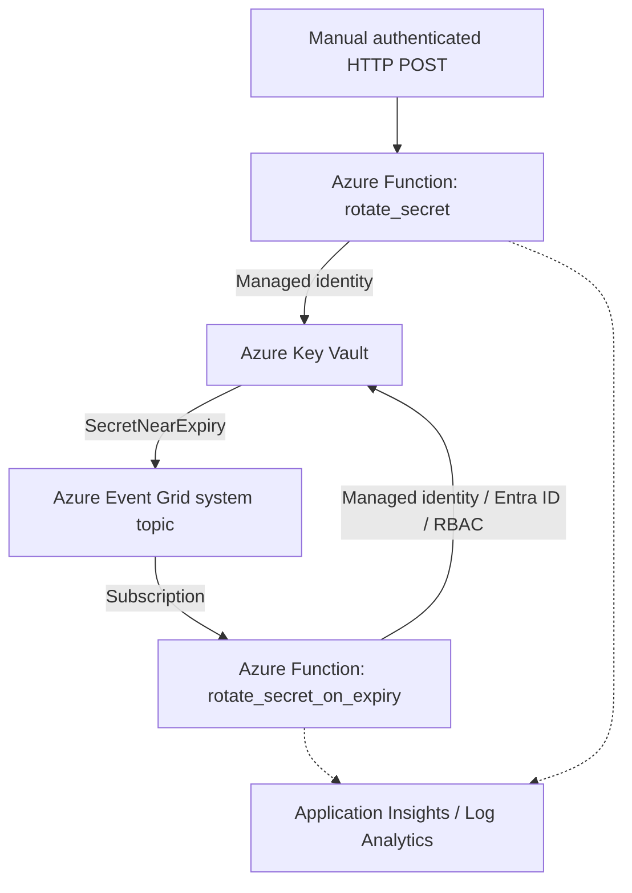

# Azure Key Vault Secret Rotation with Azure Functions and Event Grid

> **Lab status (25 October 2026):** Local and deployed HTTP secret-version rotation succeeded. Event Grid subscription was created, Event Grid trigger was deployed, and the `eventgrid_extension` system key appeared after fixing `host.json`. Invocation details are visible in Azure Portal; actual `SecretNearExpiry` delivery from Key Vault has **not** been independently demonstrated here.

## Problem statement

A credential stored in Key Vault may remain unchanged for years. Expiration policies help govern credential lifetimes, but storing a new value in Key Vault does not automatically update the credential in the target application/database. This lab implements the **Key Vault secret-version creation** portion of a rotation workflow and explores event-driven triggering and observability.

**Scope boundary:** This code generates a demonstration random secret and writes a new Key Vault version. It does **not** update a database password, refresh an application, verify downstream authentication, or revoke the old credential. Do not use it unchanged to rotate production credentials.

## Architecture



## Azure resources used in the lab

| Resource | Name / setting |
|---|---|
| Key Vault | `kv-securemart-rotation01` |
| Key Vault resource group | `rg-securemart-rotation` |
| Demonstration secret | `SecureMart-App-Credential` |
| Function App | `func-kv-rotation` |
| Function App resource group | `func-kv-rotation_group` |
| Function hosting | Linux Flex Consumption; Azure Python 3.14 at time of lab |
| Local runtime | Python 3.12 |
| Storage Account | `funckvrotationgroupa232` |
| Event Grid subscription | `evg-securemart-secret-rotation` |
| Event type | `Microsoft.KeyVault.SecretNearExpiry` |
| Function identity | System-assigned managed identity |
| Key Vault data-plane role | `Key Vault Secrets Officer` (lab) |

Names are examples and must be changed for another Azure subscription.

## Repository layout

```text
azure-keyvault-secret-rotation/
├── README.md
├── function_app.py
├── host.json
├── requirements.txt
├── .funcignore
├── .gitignore
├── local.settings.example.json
├── docs/
│   ├── troubleshooting.md
│   └── monitoring.md
└── screenshots/
    └── README.md
```

## Prerequisites

- Azure subscription and permission to create a Key Vault, Function App, Storage Account, Event Grid subscription, and role assignments.
- Azure CLI (`az`), Azure Functions Core Tools v4, Python 3.12 for local testing, and a code editor.
- Azure CLI login: `az login`.
- A Key Vault configured to use **Azure role-based access control** for data-plane authorization.
- An existing demonstration secret (do not use a real production password).
- Application Insights connected to a Log Analytics workspace if historical KQL monitoring is desired.

## 1. Create the Azure resources (portal-first)

1. Create resource group `rg-securemart-rotation` and Key Vault `kv-securemart-rotation01` in an appropriate region.
2. In Key Vault **Access configuration**, select the Azure RBAC permission model. Grant your local signed-in identity sufficient secret data-plane rights for the lab.
3. Under **Secrets**, create `SecureMart-App-Credential` with a harmless test value and an expiration date.
4. Create a Linux **Flex Consumption** Function App named `func-kv-rotation` in resource group `func-kv-rotation_group`, with its required Storage Account. Enable its **system-assigned managed identity**.
5. Under Key Vault **Access control (IAM)**, assign **Key Vault Secrets Officer** to the **Function App managed identity** (not just your user account). Wait for role propagation.
6. Configure Function App environment variables: `KEY_VAULT_URL=https://kv-securemart-rotation01.vault.azure.net/` and `SECRET_NAME=SecureMart-App-Credential`. Keep the platform-managed storage/deployment settings intact.
7. Enable Application Insights if desired; verify its linked Log Analytics workspace. Key Vault diagnostic settings are a **separate** configuration if you want Key Vault audit logs in that workspace.

> The local `az login` principal and deployed Function App managed identity are different identities. Permissions granted to one do not automatically apply to the other.

## 2. Develop locally

```bash
mkdir -p keyvault_rotation && cd keyvault_rotation
python3.12 -m venv .venv
source .venv/bin/activate
pip install -r requirements.txt
az login
```

Copy `local.settings.example.json` to `local.settings.json` and supply the required settings. Set `AzureWebJobsStorage` to a working storage connection string for local development, or use Azurite when appropriate. **Never commit `local.settings.json`.**

The project uses the Azure Functions Python v2 decorator model. `DefaultAzureCredential` uses your developer credentials locally and the Function App managed identity when deployed.

```bash
func start
```

In another terminal, invoke the HTTP test function:

```bash
curl -i -X POST http://localhost:7071/api/rotate-secret
```

Expected: HTTP 200 with `previous_version` and `new_version`. Check **Key Vault → Secrets → SecureMart-App-Credential → Versions**. Do not print the secret value.

## 3. Deploy to Azure

Validate `host.json`, then publish:

```bash
python3 -m json.tool host.json >/dev/null
func azure functionapp publish func-kv-rotation --python --build remote
```

Check indexed triggers:

```bash
az functionapp function list \
  --name func-kv-rotation \
  --resource-group func-kv-rotation_group \
  --query "[].{name:name,trigger:config.bindings[0].type}" -o table
```

Expected functions: `rotate_secret` (`httpTrigger`) and `rotate_secret_on_expiry` (`eventGridTrigger`). Local Python 3.12 and deployed Python 3.14 differed in this lab; deployment success does not alone prove runtime compatibility. Validate actual invocations and dependencies.

## 4. Test deployed HTTP rotation

In Azure Portal, navigate to **Function App → Functions → rotate_secret → Get Function URL** and select a function-scoped key. Send a **single** POST with the full private URL:

```bash
curl -i -X POST 'https://<function-app-host>/api/rotate-secret?code=<FUNCTION_KEY>'
```

Never paste the key, full signed URL, or connection strings into public issues, logs, screenshots, or GitHub. The successful response should contain version identifiers but not the new secret value.

## 5. Configure Event Grid

1. If necessary, register the subscription resource provider `Microsoft.EventGrid` under **Subscriptions → Resource providers**.
2. Open **Key Vault → Events → + Event Subscription**.
3. Source topic type: **Key Vault**; source resource group `rg-securemart-rotation`; source resource `kv-securemart-rotation01`.
4. Event schema: **Event Grid Schema**. Select only **Secret Near Expiry** (`Microsoft.KeyVault.SecretNearExpiry`).
5. Endpoint type: **Azure Function**. Select resource group `func-kv-rotation_group`, app `func-kv-rotation`, function `rotate_secret_on_expiry`.
6. Configure a subject filter for the intended secret and verify its exact subject shape using observed events; keep a matching secret-name check in code as defense in depth.
7. Create the subscription; verify provisioning state **Succeeded** and the correct endpoint.

**Timing:** Key Vault near-expiry events are generally raised approximately 30 days before expiration. Creating the subscription does not immediately generate an event. Editing a secret's expiration is not a reliable instant end-to-end test.

## 6. Test and validate

- **Local HTTP:** POST to `localhost:7071/api/rotate-secret` and verify a new version.
- **Deployed HTTP:** POST using the function key and verify a new version.
- **Event Grid handler:** Inspect **Function App → Functions → rotate_secret_on_expiry → Invocations**. A direct test of the handler does not demonstrate delivery through Event Grid.
- **Event Grid delivery:** Use **Event Grid System Topic → Metrics** to examine published, matched, delivered, and failed events when real events occur.
- **Audit:** Check Key Vault versions and configured monitoring logs, without exposing secret values.

Do not rely on repeated test events as a safe production test: this example creates a new version on each matching event and does not yet implement idempotency.

## 7. Monitoring and troubleshooting

- [Monitoring and KQL](docs/monitoring.md)
- [Real troubleshooting case studies](docs/troubleshooting.md)

## 8. Security and production gaps

This is a **demonstration**, not complete credential rotation. Before production use:

- Rotate the credential in its **authoritative target system** (database, API, etc.), not only in Key Vault.
- Support dual credentials or a carefully designed transition window, update consumers, verify new authentication, and revoke the old credential.
- Make the handler idempotent using event/version checks and an appropriate concurrency strategy; Event Grid delivery may be retried or duplicated.
- Avoid leaving a broadly invokable rotation HTTP endpoint deployed; protect or remove it after testing.
- Validate the event's source vault, type, subject, and relevant version before rotation.
- Add alerting, retry policy, dead-letter handling, monitoring, and cost controls.
- Apply least privilege; consider custom secret-scoped RBAC roles where appropriate.
- Use private connectivity and DNS when required by your network policy.
- Never log secret values, keys, tokens, or signed function URLs.

## 9. Further reading

- [Azure Functions Python developer guide](https://learn.microsoft.com/en-us/azure/azure-functions/functions-reference-python)
- [Azure Functions Event Grid trigger](https://learn.microsoft.com/en-us/azure/azure-functions/functions-bindings-event-grid-trigger)
- [Azure Key Vault Event Grid integration](https://learn.microsoft.com/en-us/azure/key-vault/general/event-grid-overview)
- [Key Vault RBAC guide](https://learn.microsoft.com/en-us/azure/key-vault/general/rbac-guide)
- [Azure Functions monitoring](https://learn.microsoft.com/en-us/azure/azure-functions/functions-monitoring)
