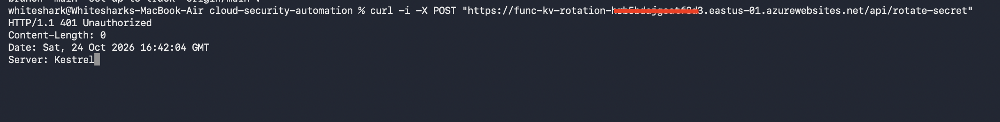
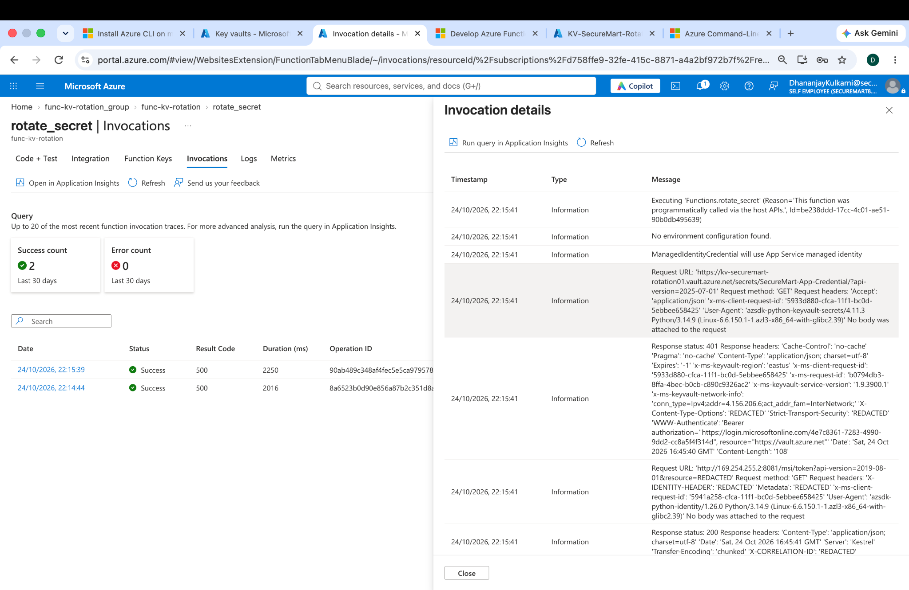
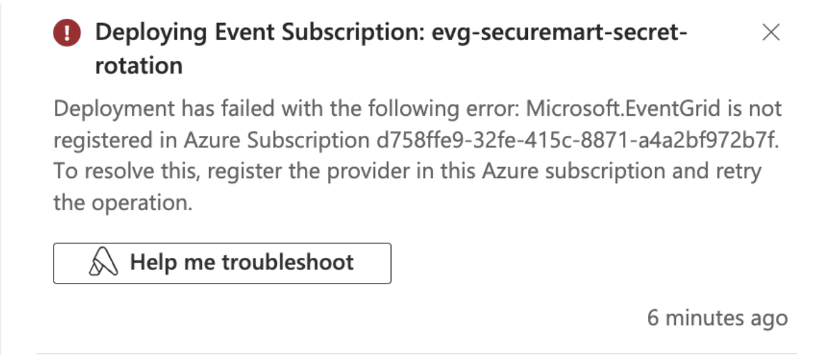
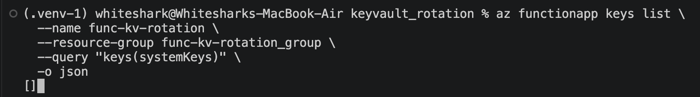

# Troubleshooting Journal — SecureMart Key Vault Rotation

These are **actual issues encountered during the lab**, not hypothetical failures. Screenshots should be placed under `../screenshots/` after sanitization. Do not publish keys, storage connection strings, tenant/subscription IDs if you consider them sensitive, signed Function URLs, or secret values.

## Case 1 — Deployed Function returned 401 Unauthorized

**Symptom:** `curl -X POST https://<app>/api/rotate-secret` returned HTTP `401`.

**Diagnosis:** The HTTP trigger used `func.AuthLevel.FUNCTION`. Local Core Tools development usually does not enforce this key requirement, but the deployed endpoint does.

**Fix:** Obtain the **function-specific URL/key** from Azure Portal → Function App → Functions → `rotate_secret` → Get Function URL. Invoke with the valid `?code=` parameter. Never publish the URL with its key.



*Figure 1: The deployed HTTP-triggered Function rejected a request without a valid Function key.*

## Case 2 — Deployed Function returned 500 / ForbiddenByRbac

**Symptom:** Authenticated HTTP invocation returned `500` and `{"status":"failed"}`. Application Insights showed:

```text
azure.core.exceptions.HttpResponseError: (Forbidden)
Action: Microsoft.KeyVault/vaults/secrets/getSecret/action
Assignment: (not found)
Inner error: ForbiddenByRbac
```

**Diagnosis:** `DefaultAzureCredential` successfully acquired a managed identity token, but the **Function App's managed identity** did not have Key Vault data-plane access. The object ID in the error matched the Function App's `principalId`. A Key Vault `401` challenge in SDK logs was not itself proof of RBAC failure; the later `403 ForbiddenByRbac` was decisive.

**Fix:** Azure Portal → Key Vault → Access control (IAM) → Add role assignment → **Key Vault Secrets Officer** → Managed identity → select the correct Function App. Allow RBAC propagation, then retest once.

**Verification:** Cloud HTTP rotation returned 200 and created a new secret version.



*Figure 2: Application Insights showed that the Function's managed identity lacked permission to read the Key Vault secret.*

## Case 3 — Microsoft.EventGrid resource provider not registered

**Symptom:** Portal prevented Event Grid configuration and indicated that the `Microsoft.EventGrid` resource provider was not registered.

**Diagnosis:** The Azure subscription had not registered the Event Grid provider.

**Fix:** Azure Portal → Subscriptions → select subscription → Resource providers → `Microsoft.EventGrid` → Register. Alternatively:

```bash
az provider register --namespace Microsoft.EventGrid --wait
az provider show --namespace Microsoft.EventGrid --query registrationState -o tsv
```

**Verification:** Provider showed `Registered`; Event Grid subscription was created and displayed `Succeeded`.



*Figure 4: The Azure subscription had not registered the Microsoft.EventGrid resource provider.*

## Case 4 — Event Grid trigger returned 404; System keys empty

**Symptom:** Portal Test/Run and direct webhook attempts returned `404`. Both Functions appeared in the function list, but App keys → System keys was empty. CLI query returned `[]`.

**Investigation:** Local `host.json` contained only the Functions host version and logging settings; it did not specify an extension bundle. The Event Grid trigger depends on the Event Grid binding extension.

**Fix:** Add:

```json
"extensionBundle": {
  "id": "Microsoft.Azure.Functions.ExtensionBundle",
  "version": "[4.0.0, 5.0.0)"
}
```

Redeploy:

```bash
func azure functionapp publish func-kv-rotation --python --build remote
```

**Verification:** Both Functions were indexed and this command returned `eventgrid_extension`:

```bash
az functionapp keys list \
  --name func-kv-rotation \
  --resource-group func-kv-rotation_group \
  --query 'keys(systemKeys)' -o json
```

**Interpretation:** The extension initialized after the configuration change. This strongly supports the missing extension bundle as the cause of the absent system key. A direct causal explanation for every earlier `404` was not independently proven; avoid claiming more than the evidence supports.

**Evidence — System keys missing**



## Case 5 — Python runtime mismatch warning

**Symptom:** Publish warned that local Python 3.12 differed from deployed Azure Python 3.14.

**Investigation:** Flex Consumption stored runtime under `properties.functionAppConfig.runtime`; traditional `linuxFxVersion` queries returned empty/null.

**Outcome:** Remote build and deployment succeeded; later HTTP Function invocation worked after RBAC was corrected. This warning was not the cause of the `ForbiddenByRbac` failure.

## Debugging sequence that worked

1. Identify the failure layer: HTTP authentication, Function execution, identity token, Key Vault authorization, extension initialization, or Event Grid delivery.
2. Inspect **Function App → Functions → [function] → Invocations** and Application Insights exceptions.
3. Read the **inner error code**, not only the top-level HTTP status.
4. Match the error's caller object ID to the Function App managed identity.
5. Confirm the right role is assigned **at the right scope**.
6. For trigger problems, check `host.json`, function indexing, extension keys, and event subscription endpoint.
7. Change one thing at a time, retest once, and record the evidence.
